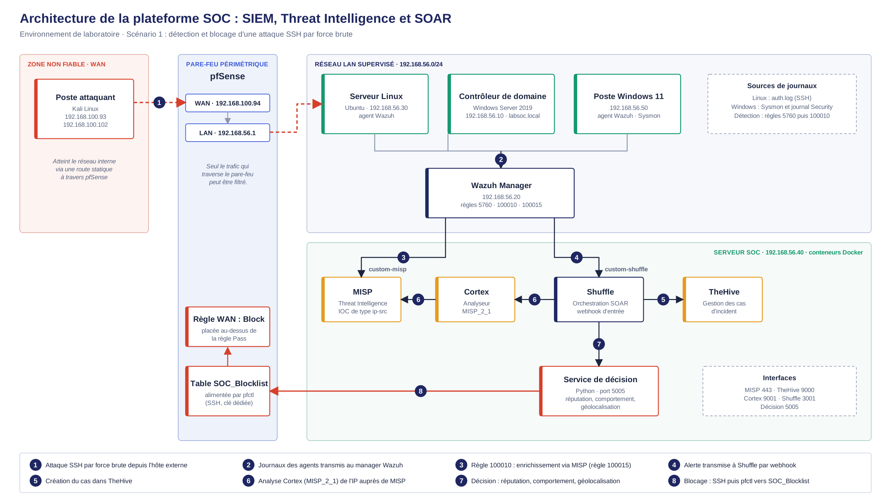
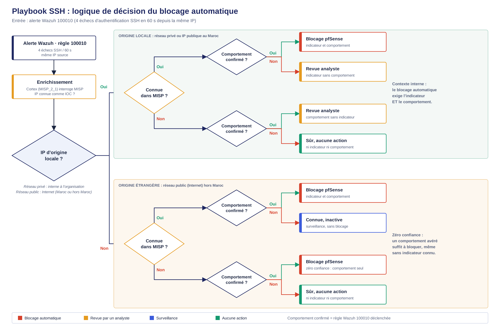
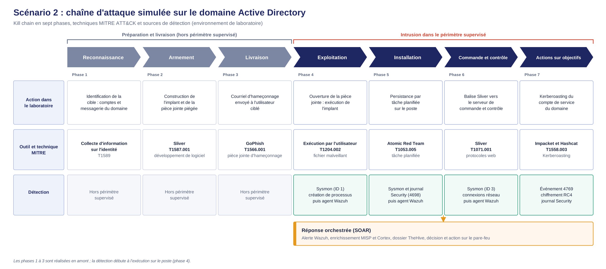

# Plateforme SOC intégrée — SIEM · Threat Intelligence · SOAR



**Conception, déploiement et validation expérimentale d'une plateforme SOC open-source complète**, de la détection jusqu'à la réponse automatisée, dans un laboratoire virtualisé reproduisant un environnement d'entreprise réaliste.

> Projet de fin d'études (PFA), stack 100 % open-source : **Wazuh** (SIEM) · **MISP** (Threat Intelligence) · **Shuffle + TheHive + Cortex** (SOAR) · **pfSense** (réponse réseau).

## En bref

| | |
|---|---|
| **MTTR, avec vs sans automatisation** | de 15–30 min à **< 90 secondes** (réduction > 90 %) |
| **MTTR mesuré, réponse automatisée** | **49 secondes** : alerte Wazuh → MISP → blocage pfSense → cas TheHive → e-mail |
| **Positions d'attaquant couvertes** | WAN externe et LAN interne micro-segmenté, sans changer la logique de décision |
| **MTTD, Scénario 2 (par phase)** | < 10 à 30 secondes selon la phase |
| **Chaînes validées** | 2 scénarios d'attaque complets, de bout en bout |
| **Référentiel** | règles de détection cartographiées MITRE ATT&CK |
| **Couverture** | 5 fonctions du NIST Cybersecurity Framework |

## Le problème

Empiler des outils de sécurité périmétriques ne suffit plus. Trois limites structurelles freinent un SOC efficace :

1. **Fatigue d'alerte** — trop d'événements, pas assez de priorisation, des incidents réels noyés dans le bruit.
2. **Contextualisation manuelle lente** — une IP ou un hash isolé a peu de valeur tant qu'il n'est pas croisé avec du renseignement sur les menaces.
3. **Réponse humaine trop lente** — même quelques minutes de délai laissent à un attaquant le temps de consolider sa présence.

## La solution

Une chaîne intégrée à trois fonctions, qui se déclenchent et se transmettent le relai automatiquement :

```
Détection (SIEM)  →  Enrichissement (Threat Intel)  →  Réponse (SOAR)
   Wazuh                    MISP                  Shuffle + TheHive + Cortex + pfSense
```

Point clé de conception : **la décision de bloquer ne repose jamais sur un seul signal**. Elle croise réputation (MISP), comportement observé (règles de corrélation Wazuh) et géolocalisation, pour éviter à la fois les faux positifs (bloquer un utilisateur légitime) et les faux négatifs (laisser passer une menace réelle). Cette logique est implémentée dans [`scripts/pfsense_blocker.py`](scripts/pfsense_blocker.py) : zéro confiance pour une IP externe (un seul signal confirmé suffit), double confirmation exigée pour une IP interne.

## Scénario 1 — Force brute SSH



Attaque par force brute SSH détectée par corrélation Wazuh (4 échecs en 60 secondes depuis la même IP), enrichie via MISP, orchestrée par Shuffle (création de cas TheHive, lancement de l'analyse Cortex), puis bloquée sur pfSense uniquement quand réputation **et** comportement confirmé coïncident (ou, pour une IP étrangère, sur un comportement confirmé seul : principe de zéro confiance).

**Résultat mesuré :** MTTD inchangé (~45 s, détection Wazuh dans les deux cas), MTTR réduit de 15–30 minutes à moins de 90 secondes.

### Réponse automatisée aux incidents — WAN et LAN micro-segmenté (MTTR 49 s)

```
Alerte Wazuh → Corrélation MISP → Blocage IP pfSense → Cas TheHive → Notification e-mail
```

La même chaîne est validée de bout en bout pour deux positions d'attaquant, chacune obligée de traverser pfSense :

- **Attaquant externe (zone WAN)** — routé via pfSense ; après blocage, la connexion SSH échoue (`Connection timed out`).
- **Attaquant interne isolé par micro-segmentation** — une interface dédiée OPT1 (`192.168.20.0/24`) sépare la machine compromise du LAN de la victime. Une **règle Floating** applique la table `SOC_Blocklist` à toutes les interfaces (WAN, LAN, OPT1), et non plus au seul WAN.

Pour l'attaquant interne, le service de décision renvoie `verdict: blocked` avec un **MTTR de 49 secondes**, l'IP est ajoutée à `SOC_Blocklist`, un cas est ouvert dans TheHive et l'analyste est notifié par e-mail. La logique de décision n'a pas été modifiée : seul le point d'application du blocage a été adapté.

Détails, topologie et contrôles complémentaires (observable inconnu de MISP, faux positif 8.8.8.8 via flux CIRCL) : [`docs/reponse-automatisee-wan-lan.md`](docs/reponse-automatisee-wan-lan.md).

## Scénario 2 — Kill Chain Active Directory



Chaîne d'attaque complète en 4 phases, outils réels d'adversary emulation (aucun malware développé) :

1. **Phishing** (GoPhish) — accès initial, volontairement non détectable au niveau système (limite documentée).
2. **Command & Control** (Sliver) — implant détecté après correction d'un angle mort de détection sur la configuration Sysmon par défaut.
3. **Persistance** (tâche planifiée) — détectée via la ligne de commande et le processus parent.
4. **Kerberoasting** (Impacket + Hashcat) — extraction et cassage hors ligne d'un ticket Kerberos, détecté via la signature RC4 de l'événement associé.

## Stack technique

| Composant | Outil | Rôle |
|---|---|---|
| SIEM | [Wazuh](https://wazuh.com/) | Collecte, normalisation, corrélation d'événements |
| Threat Intelligence | [MISP](https://www.misp-project.org/) | Enrichissement par indicateurs de compromission |
| SOAR — orchestration | [Shuffle](https://shuffler.io/) | Playbooks automatisés |
| SOAR — gestion d'incidents | [TheHive](https://thehive-project.org/) | Dossiers d'incident |
| SOAR — analyse | [Cortex](https://github.com/TheHive-Project/Cortex) | Analyseurs automatisés |
| Télémétrie Windows | [Sysmon](https://learn.microsoft.com/sysinternals/downloads/sysmon) | Processus, connexions réseau |
| Pare-feu | [pfSense](https://www.pfsense.org/) | Blocage automatisé sur décision SOAR |
| Émulation d'attaque | GoPhish, Sliver, Impacket, Hashcat, Atomic Red Team | Simulation réaliste, sans code malveillant |

## Structure du dépôt

```
.
├── architecture.png        # Vue d'ensemble de la plateforme
├── playbook-ssh.png         # Logique de décision du blocage (Scénario 1)
├── kill-chain.png           # Kill chain MITRE ATT&CK (Scénario 2)
├── LICENSE
├── docs/
│   └── reponse-automatisee-wan-lan.md   # Réponse automatisée WAN / LAN micro-segmenté (MTTR 49 s)
├── rules/                   # Règles de détection Wazuh personnalisées
│   ├── 100010-ssh-bruteforce.xml
│   ├── 100012-persistence-scheduled-task.xml
│   ├── 100014-kerberoasting.xml
│   ├── 100015-misp-enrichment-decoder.xml
│   └── 100050-sliver-c2.xml
└── scripts/                  # Logique de décision et intégrations
    ├── pfsense_blocker.py    # Service de décision à 3 critères + blocage pfSense
    └── ossec-integrations-snippet.xml
```

> **À vérifier avant de pousser** : `100012-persistence-scheduled-task.xml` a été reconstruite à partir de la description du rapport (section 7.6.1), qui n'en cite pas le XML littéral. Vérifie ses champs exacts contre ta configuration réelle avant de t'y fier.

## Ce que ce dépôt ne contient pas

Ce projet a été réalisé dans le cadre d'un stage en entreprise. Les éléments propres à l'organisation d'accueil (nom, captures d'écran internes, données de contexte) ont été retirés ou anonymisés. Ce qui est publié ici est le travail technique : architecture, règles de détection, logique de décision, scripts d'intégration et résultats de performance.

## Licence

[MIT](LICENSE)
